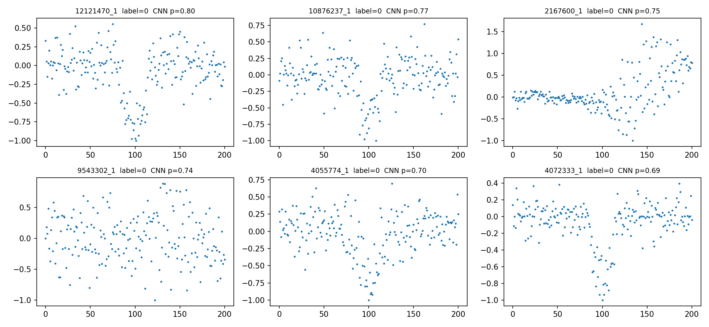
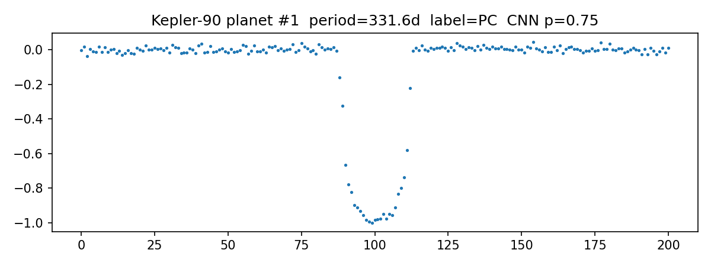

# Exoplanet Finder

A two-view 1D CNN that tells real planets from false positives in NASA Kepler light curves.

## Data
NASA Kepler Q1-Q17 DR24 TCE table (labels: PC = planet, AFP/NTP = not planet). Light curves downloaded per star with lightkurve.

## Method
1. Split by star (no star appears in both train and test)
2. Flatten the light curve with transits masked, then fold on the TCE period
3. Two views: global (2,001 bins) and local (201 bins)
4. Two-branch 1D CNN, trained 100 epochs with flip augmentation
5. Baseline: gradient boosting on period, duration and depth only

## Results
Held-out test: 398 TCEs (82 planets), split by star.

| Model | Training data | Test AUC |
|---|---|---|
| Baseline (period, duration, depth) | 14,193 rows | 0.947 |
| Baseline (period, duration, depth) | 999 rows | 0.934 |
| CNN (40 epochs) | 999 stars | 0.931 |
| CNN (100 epochs + flip) | 999 stars | 0.944 |

With the same 999 training examples, the CNN scored 0.944 versus 0.934 for the baseline. With the full training table the baseline scores 0.947, so the CNN did not beat it. With only 82 test planets, a 0.01 AUC difference may be noise.

## Figures
False positives (local views the CNN got wrong):

Kepler-90 (KIC 11442793), planet #1 (period 331.6 days): the model gives p = 0.75.

## Limitations
- The CNN was trained on only 999 stars, so more data should help
- Small test set (82 planets)
- Some Kepler "false positive" labels may be label errors

## Run it
Open exoplanet_finder.ipynb in Google Colab and run the cells in order.
